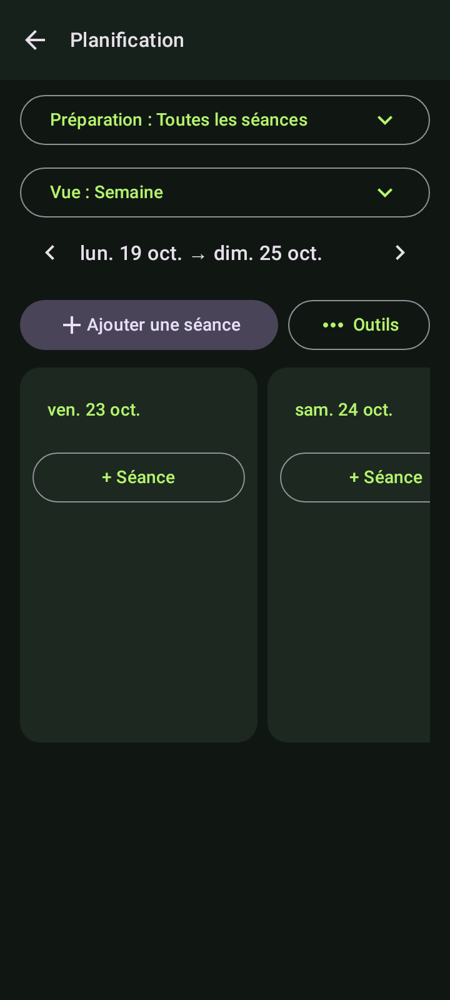
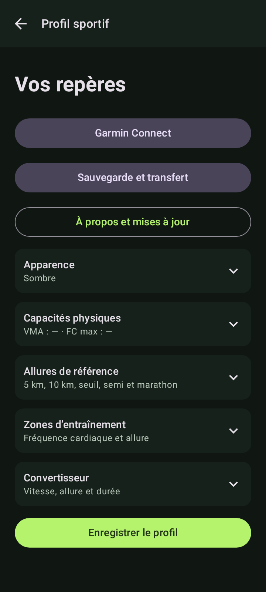

# Hybrid Coach

Application Android native de planification et de suivi de course à pied et de musculation, avec données locales et fonctions utilisables hors ligne. La synchronisation Garmin facultative nécessite Internet. Interface française, thème sombre par défaut, thèmes clair et système disponibles.

[Télécharger la dernière version](https://github.com/douwwii/HybridCoach/releases/latest) · [Historique](CHANGELOG.md) · [Signaler un problème](https://github.com/douwwii/HybridCoach/issues/new/choose)

## Installer et mettre à jour

Télécharger l’APK dans les **Releases** du dépôt, l’ouvrir sur le téléphone et confirmer l’installation. Pour conserver le carnet, installer les mises à jour par-dessus la version précédente, sans désinstaller.

À partir de la version **1.7**, ouvrir **Profil sportif → À propos et mises à jour** pour rechercher une version, consulter ses nouveautés, télécharger l’APK vérifié et ouvrir l’installateur Android. Aucun compte GitHub ni serveur personnel n’est nécessaire. [Guide des mises à jour](docs/MISES_A_JOUR.md).

Le carnet reste local et la sauvegarde JSON permet son transfert vers un autre téléphone. Les clés Garmin restent propres à chaque installation. [Sauvegarde et restauration](docs/SAUVEGARDE.md).

## Fonctionnement

- Planification sur plusieurs semaines : vues jour, semaine, mois et préparation complète.
- Réajustement rapide, sous-objectifs datés et répétitions imbriquées.
- Course à pied, musculation, autres sports, résultats et statistiques.
- Import Garmin facultatif par clé personnelle, sans serveur.
- Interface française avec détails et réglages dépliants.

Guides : [Planification](docs/PLANIFICATION.md) · [Interface](docs/INTERFACE.md) · [Garmin](docs/GARMIN.md).

## Publier une nouvelle version

Le dépôt contient les sources et la documentation ; les APK, archives et rapports générés sont distribués dans les Releases et les artefacts de vérification. Les clés privées restent hors de Git.

Après mise à jour des numéros de version et de `CHANGELOG.md`, un tag `vX.Y.Z` déclenche les tests et la création d’un brouillon de publication. La signature doit être configurée une fois dans les secrets GitHub. Une préparation et un téléversement locaux sont également possibles. [Procédure complète](docs/PUBLICATION_GITHUB.md).

## Documentation et développement

- [Installer et mettre à jour](docs/MISES_A_JOUR.md)
- [Compiler et contribuer](docs/DEVELOPPEMENT.md)
- [Architecture et migrations](docs/ARCHITECTURE.md)
- [Vérifications et limites](docs/VERIFICATION.md)
- [Préparer une publication GitHub](docs/PUBLICATION_GITHUB.md)

Les signalements peuvent être créés depuis [Issues](https://github.com/douwwii/HybridCoach/issues/new/choose). Ne joindre aucune clé Garmin ni sauvegarde contenant des données personnelles.

## Aperçu

 
